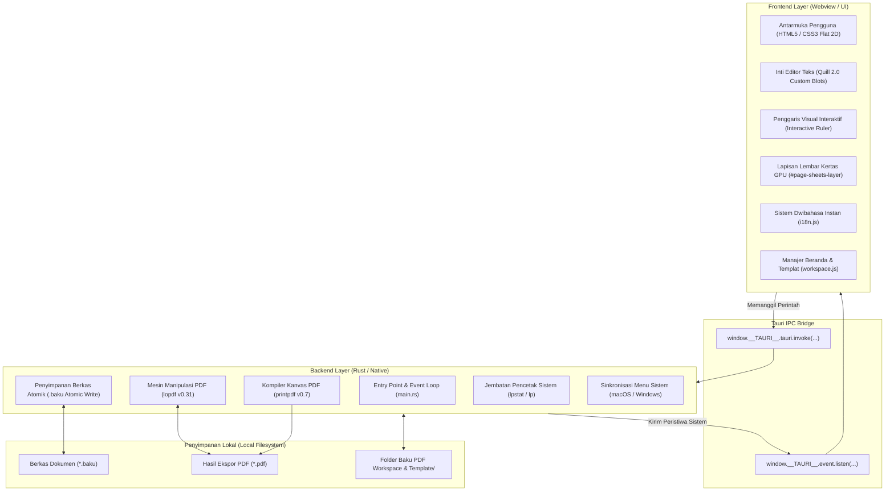
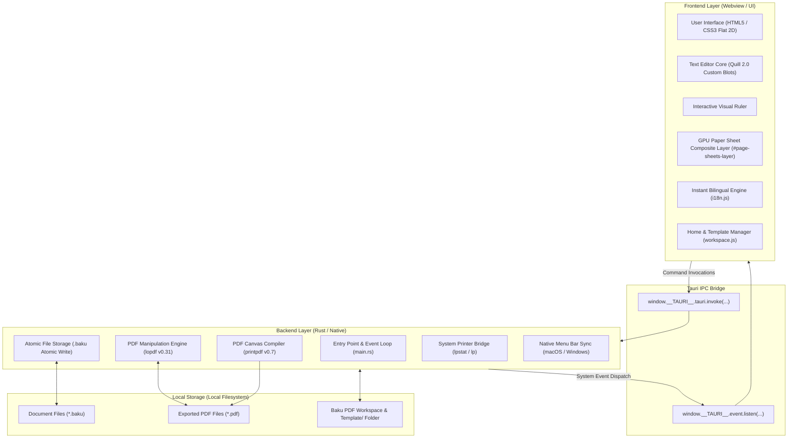

# Arsitektur Teknis Baku PDF / Technical Architecture

**Languages / Bahasa**: [Bahasa Indonesia](#bahasa-indonesia) | [English](#english)

---

## Bahasa Indonesia

Dokumen ini menjelaskan arsitektur teknis, desain sistem, aliran komunikasi antar-proses, serta spesifikasi format berkas mandiri pada aplikasi **Baku PDF**.

### 1. Filosofi Desain & Prinsip Utama

Baku PDF dirancang dengan tiga prinsip arsitektural inti:
1. **100% Local-First & Bebas Server**: Seluruh penulisan dokumen, pemrosesan tata letak, dan manipulasi biner PDF berlangsung secara lokal di memori dan prosesor perangkat pengguna. Tidak ada data yang dikirim ke server luar.
2. **Kinerja Tinggi & Hemat Memori**: Memanfaatkan **Tauri** (Rust + Webview native sistem operasi) alih-alih Electron. Aplikasi berjalan dengan konsumsi memori RAM sangat rendah (~50–80 MB) dan startup instan (< 1 detik).
3. **Deterministik & Standar Baku**: Setiap dokumen mempertahankan spesifikasi margin resmi (seperti standar 4-4-3-3 cm untuk karya ilmiah perguruan tinggi), format penomoran multi-seksi, dan kompilasi ekspor WYSIWYG presisi piksel.

### 2. Diagram Arsitektur Tingkat Tinggi

Aliran sistem terbagi menjadi dua lapisan utama yang berkomunikasi melalui jembatan antarmuka IPC (*Inter-Process Communication*) asinkron:



### 3. Komponen Utama Sistem

#### A. Lapisan Frontend (Webview)
- **Editor Core (`src/main.js`)**: Menggunakan Quill 2.0 yang dikustomisasi dengan embed blot khusus (`PageBreakBlot` dan `SectionBreakBlot`) untuk mengisolasi pengetikan antar-halaman secara bersih.
- **Lapisan Lembar Kertas Mandiri (`#page-sheets-layer`)**: Lembar-lembar kertas fisik putih dirender sebagai elemen komposit independen di belakang teks (`z-index: 0`). Pendekatan ini menghilangkan beban rasterisasi SVG berulang dan di-*cache* langsung oleh GPU untuk pengguliran 60 FPS yang mulus.
- **Penggaris Visual Interaktif**: Memantau koordinat seleksi kursor secara *real-time* dan menyinkronkan penanda *First Line Indent*, *Left Indent*, dan *Right Margin* ke gaya paragraf aktif.
- **Sistem Dwibahasa (`src/i18n.js`)**: Melakukan pemindaian DOM TreeWalker untuk menerjemahkan teks antarmuka secara instan antara Bahasa Indonesia dan Bahasa Inggris tanpa memicu render ulang kanvas dokumen.

#### B. Lapisan Backend (Rust)
- **Penulisan Berkas Atomik (`save_baku_file`)**: Menyimpan dokumen ke berkas sementara tersembunyi (`.<nama>.tmp-<pid>`), melakukan `flush` buffer, `sync_all` ke media penyimpanan fisik, lalu melakukan penggantian nama (*atomic rename*) ke berkas tujuan. Mencegah berkas rusak jika terjadi pemadaman listrik.
- **Alat Ekstra PDF (`merge_pdf_files`, `split_pdf_file`, `rotate_pdf_file`, `images_to_pdf`)**: Membaca dan memodifikasi struktur pohon objek PDF (*cross-reference table*, kamus *Pages*, dan *Catalog*) secara langsung di level byte menggunakan pustaka `lopdf` berkecepatan tinggi tanpa memakan banyak memori.
- **Deteksi & Integrasi Pencetak Sistem (`get_system_printers`, `send_to_printer`)**: Berkomunikasi langsung dengan subsistem CUPS (`lpstat`, `lp`) pada macOS/Linux dan winspool pada Windows untuk pencetakan multi-eksemplar langsung.
- **Pengaman Instalasi DMG (`check_running_from_dmg`)**: Pada macOS, mendeteksi jika aplikasi dijalankan dari volume DMG sementara (`/Volumes/`), menampilkan panduan resmi, dan menawarkan penyalinan otomatis ke `/Applications`.

### 4. Spesifikasi Format Berkas Mandiri (.baku)

Berkas berekstensi `.baku` adalah format dokumen berbasis JSON terstruktur yang menyimpan konten teks kaya, tata letak, dan metadata secara lengkap:

```json
{
  "docName": "Skripsi_Bab_1",
  "templateMeta": {
    "id": "skripsi",
    "title": "Skripsi / Tugas Akhir",
    "category": "academic",
    "isStrictStandard": true,
    "paperSize": "A4",
    "orientation": "portrait",
    "marginSummary": "4-4-3-3 cm",
    "fontSummary": "Times New Roman, 12pt, Spasi 1.5",
    "desc": "Format baku karya ilmiah perguruan tinggi.",
    "keywords": ["skripsi", "akademik", "tugas akhir"]
  },
  "paperConfig": {
    "width": 210,
    "height": 297,
    "marginTop": 40,
    "marginBottom": 30,
    "marginLeft": 40,
    "marginRight": 30,
    "orientation": "portrait",
    "format": "A4"
  },
  "numberingConfig": {
    "doc": {
      "show": true,
      "format": "arabic",
      "start": 1,
      "align": "right",
      "diffFirst": true
    }
  },
  "headerFooterConfig": {
    "doc": {
      "header": { "text": "", "align": "center", "diffFirst": false },
      "footer": { "text": "", "align": "center", "diffFirst": false }
    }
  },
  "content": [
    {
      "insert": "BAB I\nPENDAHULUAN\n",
      "attributes": {
        "bold": true,
        "align": "center",
        "font": "Times New Roman",
        "size": "12pt"
      }
    }
  ]
}
```

### 5. Saluran Ekspor Dokumen ke PDF (WYSIWYG Pipeline)

1. **Persiapan Sesi Ekspor**: Sembunyikan panduan visual (garis batas pemisah halaman, lapisan `#page-sheets-layer`, kursor pengetikan).
2. **Kompilasi Konten**: Kanvas dokumen `#export-wrapper` dibaca dengan skala dimensi presisi (milimeter ke piksel pada rasio 96 DPI / 72 DPI standar cetak).
3. **Rendering Berkas**: Pustaka `html2pdf.js` merender DOM menjadi struktur halaman kanvas PDF murni dengan konfigurasi margin, ukuran lembar, dan penomoran yang identik dengan tampilan di layar.
4. **Pembersihan State**: Mengembalikan status tampilan editor ke mode penyuntingan interaktif dan menampilkan modal berhasil ekspor.

---

## English

This document provides a comprehensive technical breakdown of the system architecture, inter-process communication (IPC) model, and storage specifications in **Baku PDF**.

### 1. Design Philosophy & Core Principles

Baku PDF is engineered around three foundational pillars:
1. **100% Local-First & Serverless**: Document drafting, page layout calculations, and PDF binary transformations are executed entirely on local client hardware and memory. Zero bytes leave your device.
2. **High Performance & Resource Efficiency**: Built on **Tauri** (Rust + native OS Webview) instead of Electron. Memory footprint remains ultra-low (~50–80 MB RAM) with instantaneous application boot (< 1s).
3. **Deterministic Standard Compliance**: Preserves official formatting standards (such as academic 4-4-3-3 cm margins), multi-section numbering, and pixel-precise WYSIWYG export fidelity.

### 2. High-Level Architecture Diagram

The system comprises two core layers communicating through an asynchronous Tauri Inter-Process Communication (IPC) bridge:



### 3. Core System Components

#### A. Frontend Layer (Webview)
- **Editor Engine (`src/main.js`)**: Built upon Quill 2.0 extended with custom blot embeddings (`PageBreakBlot` and `SectionBreakBlot`) to isolate page flow and prevent text-overflow layout recalculation loops.
- **GPU Paper Sheet Compositor (`#page-sheets-layer`)**: Rendered as an independent z-index layer behind the text. Eliminates repeated SVG rasterization bottlenecks and leverages GPU tile caching for silky 60 FPS scrolling.
- **Interactive Visual Ruler**: Listens to cursor selection changes in real time and aligns First Line Indent, Left Indent, and Right Margin markers with active paragraph CSS attributes.
- **Bilingual Subsystem (`src/i18n.js`)**: Executes DOM TreeWalker scans to swap interface strings dynamically between Indonesian and English without invalidating editor state.

#### B. Backend Layer (Rust)
- **Atomic File Storage (`save_baku_file`)**: Writes document data to a hidden temporary buffer (`.<name>.tmp-<pid>`), invokes `flush()`, forces disk persistence with `sync_all()`, and executes an atomic filesystem rename. Prevents file corruption during unexpected power outages.
- **Offline PDF Extra Utilities (`merge_pdf_files`, `split_pdf_file`, `rotate_pdf_file`, `images_to_pdf`)**: Manipulates underlying PDF object trees (*Pages* dictionary, *Catalog*, and cross-reference tables) at byte-level using the high-performance `lopdf` crate.
- **Native Print Spooling (`get_system_printers`, `send_to_printer`)**: Communicates with CUPS subsystems (`lpstat`, `lp`) on Unix platforms and Windows winspool to deliver direct multi-copy printing.
- **DMG Launch Guard (`check_running_from_dmg`)**: Detects execution from temporary read-only disk image volumes on macOS and initiates an automated install flow into `/Applications`.

### 4. Native Document Format Specification (.baku)

Files with the `.baku` extension represent structured JSON documents encapsulating rich-text deltas, geometry settings, and metadata:

```json
{
  "docName": "Thesis_Chapter_1",
  "templateMeta": {
    "id": "skripsi",
    "title": "Undergraduate Thesis",
    "category": "academic",
    "isStrictStandard": true,
    "paperSize": "A4",
    "orientation": "portrait",
    "marginSummary": "4-4-3-3 cm",
    "fontSummary": "Times New Roman, 12pt, 1.5 Spacing",
    "desc": "Standard academic formatting for universities.",
    "keywords": ["thesis", "academic", "research"]
  },
  "paperConfig": {
    "width": 210,
    "height": 297,
    "marginTop": 40,
    "marginBottom": 30,
    "marginLeft": 40,
    "marginRight": 30,
    "orientation": "portrait",
    "format": "A4"
  },
  "numberingConfig": {
    "doc": {
      "show": true,
      "format": "arabic",
      "start": 1,
      "align": "right",
      "diffFirst": true
    }
  },
  "headerFooterConfig": {
    "doc": {
      "header": { "text": "", "align": "center", "diffFirst": false },
      "footer": { "text": "", "align": "center", "diffFirst": false }
    }
  },
  "content": [
    {
      "insert": "CHAPTER I\nINTRODUCTION\n",
      "attributes": {
        "bold": true,
        "align": "center",
        "font": "Times New Roman",
        "size": "12pt"
      }
    }
  ]
}
```

### 5. WYSIWYG PDF Export Pipeline

1. **Session Preparation**: Conceals non-printable visual indicators (page break boundary markers, `#page-sheets-layer` composite shadows, active caret).
2. **Geometry Scaling**: The `#export-wrapper` DOM canvas is parsed with exact millimeter-to-pixel ratios corresponding to the standard 96 DPI / 72 DPI print rasterization baseline.
3. **PDF Canvas Rasterization**: Compiled via `html2pdf.js` into authentic PDF pages matching the exact margin boundaries and numbering positions shown on screen.
4. **State Cleanup**: Restores interactive UI controls and displays the export completion modal.
